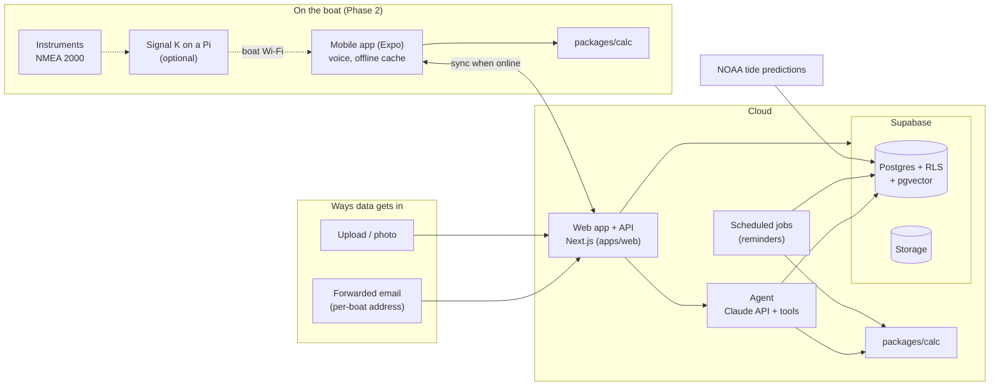
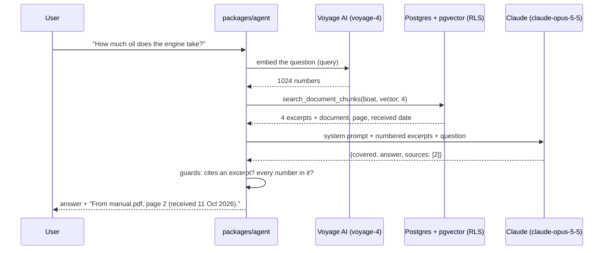
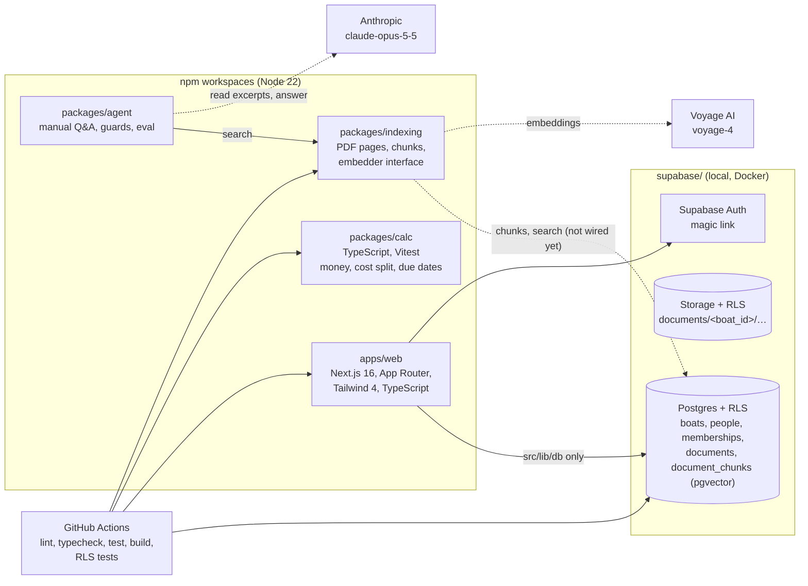
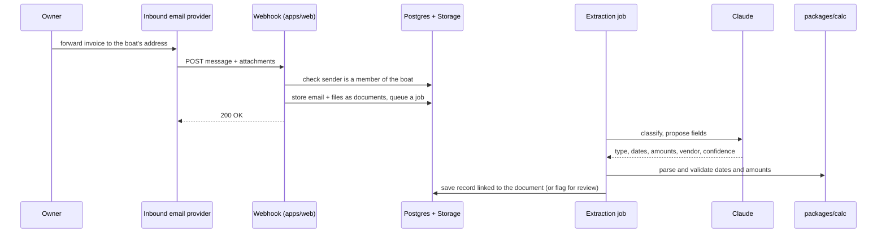
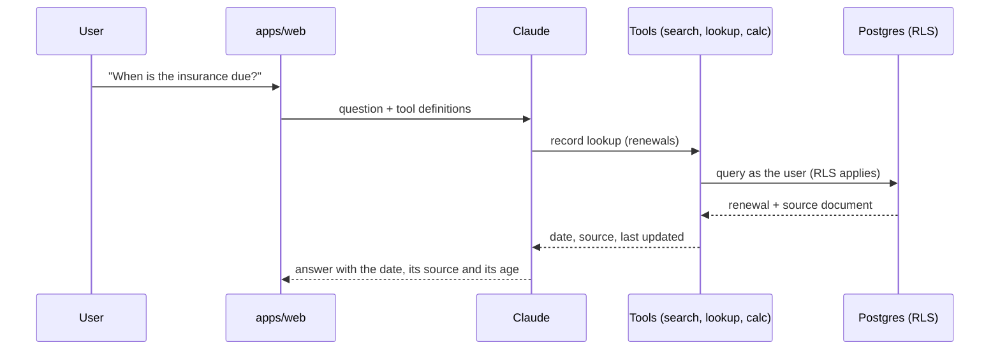
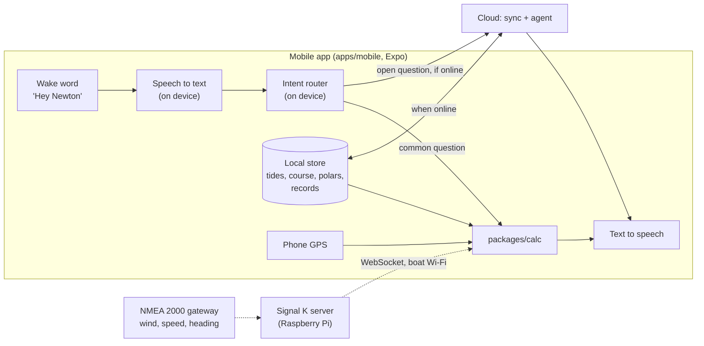

# Architecture

How Newton is built today, and what each build phase adds. The product view (users, data
model, agent tools, risks) is in the [Newton — Product & Architecture Spec](https://docs.google.com/document/d/19byJe41PNjezQD93sBnIgbE90bdVzTzWd5ptSrVg5yU/edit) in the team Google
Drive; this page is the engineering view and stays in step with the code.

**Status (last updated 2026-10-19):** Phase 1: scaffold, plus boats, people, memberships,
magic-link sign-in, adding your first boat, a per-boat document store, renewals, maintenance and
expenses with a boat page that shows them, and manuals split into searchable chunks; a hosted dev
database migrated and seeded from `main`. What exists today is in
[Today: the scaffold](#today-the-scaffold); every other section describes a target, not running
code. Update this line when a phase's components land.

Anything marked **(open)** has not been decided yet. Each open choice gets a short decision record
in `docs/decisions/` when an issue needs it.

- [The target shape in one picture](#the-target-shape-in-one-picture)
- [Rules every part follows](#rules-every-part-follows)
- [AI models: who does what](#ai-models-who-does-what)
- [Today: the scaffold](#today-the-scaffold)
- [Phase 1 target: home side for our own boat](#phase-1-target-home-side-for-our-own-boat)
- [Phase 2 target: on-water voice](#phase-2-target-on-water-voice)
- [Phase 3 target: friends' boats](#phase-3-target-friends-boats)
- [Phase 4 target: paid product](#phase-4-target-paid-product)
- [Open decisions](#open-decisions)

## The target shape in one picture

This is where the phases lead, not what runs today. One cloud service holds every boat's record. The web app (Phase 1) and the mobile app (Phase 2)
read and write it; on the boat, the mobile app works from a cached copy and syncs when it has
signal. Every number comes from `packages/calc`, which runs both in the cloud and on the phone.



## Rules every part follows

These are the [principles](../README.md#principles) turned into technical rules.

| Principle | Technical rule (applies as each part is built) |
| --- | --- |
| 1. The boat is the tenant | Every table has a `boat_id`. Access is enforced by Postgres row-level security (RLS) from a person's membership on that boat, not by app code. User requests run with the user's own token, so RLS applies. The service role (which bypasses RLS) is only used by server jobs and webhooks, which always filter by an explicit `boat_id`. |
| 2. Numbers from code | Tides, bearings, target angles, dates and cost splits live in `packages/calc` as pure, unit-tested functions. The agent gets numbers only as tool results; values extracted from documents are parsed and validated by `calc` before saving. Money is integer cents. |
| 3. Zero data entry | Email-in and upload are the main input paths. Forms are only for correcting what extraction proposed. |
| 4. Offline first on the boat | `packages/calc` has no Node, browser or network dependencies, so the phone will be able to run it offline in Phase 2. Anything the on-water assistant needs is cached on the phone. |
| 5. Owners own their data | Every record and file can be exported per boat. Nothing about a boat lives outside the boat's rows and its storage folder, so a record can move to a new owner. |
| 6. Safety framing | Every fact carries its source (document, page, station) and its timestamp, so answers can say where a number came from and how old it is. Records keep an audit trail: who added or changed them, and from which email or file. |

## AI models: who does what

Newton uses two hosted models today, each for one narrow job, and keeps everything else in
code. Neither model is the source of a number, a date or a citation: Voyage only decides which
pages are worth reading, Claude only phrases what those pages say, and code checks the result.

| Model | Provider | Its job | What it is sent | What it never does | Code | Key | In tests and CI |
| --- | --- | --- | --- | --- | --- | --- | --- |
| `voyage-4`, 1024 dimensions | Voyage AI | Turns manual chunks (`input_type: "document"`) and questions (`"query"`) into vectors, so pgvector can find the closest pages | Text of documents of type `manual` (later owner-written procedures, #21), and the question. Training on our content is opted out. | See invoices, insurance, contracts or email bodies; answer anything | `packages/indexing` (`VoyageEmbedder` behind the `Embedder` interface) | `VOYAGE_API_KEY` | `FakeEmbedder` (deterministic bag of words), no key |
| `claude-opus-5-5`, low effort | Anthropic | Reads the few excerpts search found and returns `{covered, answer, sources}` as structured output | The fixed system prompt (cached) and up to four numbered excerpts with their document name and page, plus the question | Search, compute, write the citation, or answer from general knowledge | `packages/agent` (`ClaudeAnswerModel` behind the `AnswerModel` interface) | `ANTHROPIC_API_KEY` | A scripted stand-in model, no key |

Claude has no embeddings API, which is why retrieval and answering come from two providers
([decision 0004](decisions/0004-embeddings.md)). Similarity search itself is not a model: it is
`search_document_chunks()` in Postgres, running as the person asking, so row-level security keeps
each boat's manuals to its own members.

### One question, end to end



Indexing is the same first step done ahead of time: when a document becomes a manual, its PDF
text is split into chunks that keep their page, each chunk is embedded by Voyage as a
`document`, and the vectors are stored in `document_chunks` with the model that made them.

### What code checks after Claude answers

- **Sources come from the excerpts, not the model.** Claude returns excerpt numbers; code turns
  them into document, page and received date. An answer that cites no excerpt it was given is
  withheld.
- **Every number must be in a cited excerpt.** If the answer has a figure that isn't written in
  the excerpts it cites (converted, added up or invented), it is withheld (principle 2).
- **Saying no is a normal answer.** Nothing found, Claude saying the excerpts don't cover it, a
  safety refusal (retried once on Anthropic's server-side fallback model), all give "The boat's
  manuals on Newton don't cover that, so I won't guess." A cut-off or malformed reply is an error,
  not an answer.

### Changing a model

Both models sit behind an interface, so a change is a new class, not a rewrite.

- **Embeddings:** every chunk stores `embedding_model`, and search only compares a question with
  chunks from the same model, so a switch re-embeds boat by boat. Another 1024-dimension model
  (`mistral-embed`, `bge-m3`) is a re-embed; any other size needs a migration. What would trigger a
  switch (EU processing, missed pages, Voyage's terms, offline on the phone) is in
  [decision 0004](decisions/0004-embeddings.md).
- **Claude:** `DEFAULT_MODEL` in `packages/agent/src/claude.ts`; the live eval takes
  `NEWTON_QA_MODEL` to try another one. A model change lands only with a passing
  `npm run eval:manual-qa` run.

### Coming next

| Use | Model | When |
| --- | --- | --- |
| Extraction: classify each filed document and propose fields (dates, amounts, vendor) | Claude, structured output; `calc` validates every date and amount before saving | #11 |
| Questions about records ("when is the insurance due?") | Claude with tools (record lookup, `calc`), the answer built only from tool results | After #14 |
| Voice on the boat: wake word, speech to text, text to speech | On-device engines, so they work offline **(open)** | Phase 2 |
| Search offline on the phone | A small open embedding model on the device, with the boat's chunks re-embedded for it ([decision 0004](decisions/0004-embeddings.md)) | Phase 2, if needed |
| Cost per boat | Log Claude and Voyage tokens per boat | Phase 3 |

On the water, common questions (tide, course to mark, target angle) never reach a model: an
on-device intent router calls `calc` directly. Only open questions go to Claude, and only when
there is signal.

## Today: the scaffold

What is in `main` now (after [#18](https://github.com/heynewton/newton/pull/18) and
[#20](https://github.com/heynewton/newton/pull/20)): a monorepo with a homepage and the first `calc`
functions. Since #5: a local Supabase stack with boats, people and memberships under row-level
security, and email magic-link sign-in in the web app. Since #8: a per-boat document store (a
`documents` table and a private Storage bucket, both under RLS). Since #32: a signed-in person adds
a boat and becomes its owner. Since #60: a hosted Supabase **dev** project (`newton-dev`), migrated
and seeded with the sample boat on every push to `main`. Since #15: a boat's page shows its
renewals and maintenance with due dates, the co-owner balance and its documents. Since #13: manuals can be split into chunks
with page numbers, embedded and searched under RLS (`packages/indexing`, `document_chunks`), though
nothing calls it yet. Since #10: each boat has its own email address, and Resend's webhook
(`/api/email-in`) files mail from the boat's members as documents (the original message and its
attachments) and holds mail from anyone else. Since #12: a daily job (Vercel Cron → `/api/reminders`)
emails each owner and co-owner one digest of what is overdue or coming up on their boats. There is no
prod project or agent yet.



| Part | Where | State |
| --- | --- | --- |
| Web app | `apps/web` | Homepage, placeholder `/get-started`, `/privacy` and `/terms`, and a shared footer from the root layout (#31). Previews per PR (#19). |
| Sign-in and boats | `apps/web/src/app/sign-in`, `auth/callback`, `boats` | Email magic link (#5). A proxy (`src/proxy.ts`) refreshes the session cookie and sends a signed-in person from `/` to `/boats`, which goes on to `/boats/new` (no boat), their one boat, or a picker (#32). `/boats/new` asks only for the name; `/boats/<id>` is the boat's home: renewals and maintenance with due dates, the co-owner balance and the documents, each record linking to its file through a short-lived signed URL (#15), then next steps. `src/lib/records` maps rows to `packages/calc` inputs. Without `SUPABASE_URL` and `SUPABASE_PUBLISHABLE_KEY`, `/sign-in` stays a placeholder; the dev site and previews get `newton-dev`'s from the Deploy workflow (#62). The email link returns to the origin it was requested from. |
| Data access | `apps/web/src/lib/db` | The web app's only way into the database and auth; a lint rule blocks `@supabase/*` imports elsewhere. Types generated from the schema (`npm run db:types`). |
| Calc | `packages/calc` | Money helpers (`toCents`, `formatCents`), the co-owner cost split (`splitCosts`, #6), due dates for renewals and maintenance (`nextDue`, `findDue`, #7), and for Phase 2 the tide height between cached high and low waters (`tideHeightAt`, #78), the bearing, distance and time to a mark (`bearingAndDistance`, `timeToMark`, #79) and the course to steer for tidal stream and leeway (`courseToSteer`, #80), with tests. Imported as source (`main: src/index.ts`), no build step. |
| Brand | `assets/brand` | Logo, favicon, monochrome marks. |
| CI | `.github/workflows/ci.yml` | `npm ci`, lint, typecheck, test, build on every PR and on `main`; a second job starts Postgres and runs the RLS tests. |
| History | `.github/workflows/history.yml`, `scripts/history.mjs` | After every merge that adds a `docs/history/` file, rebuilds `docs/history.md` and commits it to `main` as the `heynewton-history` GitHub App, the one bypass on the "Protect main" ruleset (#89). |
| Dev database | Supabase project `newton-dev`, `.github/workflows/dev-database.yml` | Holds only fixture data. On every push to `main`, the workflow runs `supabase db push` with the checked-in migrations, then loads `supabase/seed.sql` with `psql` (the seed is safe to re-run, and resets the sample boat's rows to `boat.json`). PRs that touch `supabase/` or the sample boat get a dry run against dev that changes nothing. The dev site and every PR preview sign in against it (#62); its Auth URL configuration allows the dev site, heynewton.app and preview URLs. Unlike the local stack, it doesn't expose new tables to the Data API roles, so every migration grants explicitly. |
| Hosting | Vercel project `heynewton-web` | `main` deploys to the dev site, https://heynewton-web.vercel.app, which [heynewton.app](https://heynewton.app) also points at (DNS on Cloudflare, `www` redirects to the apex). Previews and the dev site get `newton-dev`'s URL and publishable key from repo variables, passed by `.github/workflows/deploy.yml` at build and run time (#62), so they hold fixture data only; #37 moves the domain to a production project before real boat data (#35). |
| Fixtures | `fixtures/sample-boat` | One invented boat (Kittiwake): boat, people, memberships with ownership shares, renewals, maintenance items and expenses in `boat.json`, four fake documents as text and PDF, five inbound `.eml` files. PDFs and emails are generated by `build.mjs`. |
| Database and auth | `supabase/` | Local stack via the Supabase CLI (`npm run db:start`). Migration: `boats`, `people` (Newton's own `id`; the provider's user ID only in `auth_subject`, not readable through the API), `memberships` with role (owner, co-owner, crew, read-only) and ownership share. Records migration (#9): `renewals` (kind, expiry date), `maintenance_items` (interval in months and/or engine hours, last done date and hours) and `expenses` (integer cents and currency, paid by a person on the boat), each with a `boat_id` and a `document_id` pointing at its source document (set to null if the document is deleted), shaped like `calc`'s inputs. Policies go through `current_person_id()`; record tables use `can_read_boat()` and `can_write_boat()`. Boats are created only through `create_boat(name)`, which inserts the boat and the caller's `owner` membership in one transaction (#32). `seed.sql` is generated from the sample boat, including its four documents, with the records linked to them; the CLI uploads the matching files into the `documents` bucket from `supabase/storage/documents` (symlinks to the fixture PDFs) on start and reset (#76). pgTAP tests in `supabase/tests`, sharing the people and boats in `setup/tenancy.psql` (`npm run db:test`). The same migrations run on the hosted dev project (see Dev database). |
| Document store | `supabase/migrations/…_documents.sql` | A private `documents` bucket with one folder per boat (`<boat_id>/…`), and a `documents` table (boat, storage path, type, source email or upload, received date, filename, content type, size, who added it). The same roles apply to both: members read; owners, co-owners and crew add; owners and co-owners delete; read-only members only read. Files can't be overwritten (no update policy), and a row's path must be in its own boat's folder. Nothing uploads yet; email-in (#10) and upload (Phase 3) will. |
| Document search | `packages/indexing`, `supabase/migrations/…_document_chunks.sql` | pgvector, and `document_chunks` (boat, document, page, chunk text, `vector(1024)` embedding, the model that made it), with the same roles as `documents`: members read, writers add and remove, no edits. `search_document_chunks()` returns the closest chunks with the document's name and dates, runs as the caller and only ever sees their own boats. The package extracts text per page from a PDF (`unpdf`), splits it into chunks that never span pages, embeds them through an `Embedder` interface (Voyage AI `voyage-4` in production, a deterministic fake in tests, so CI needs no key) and replaces the document's chunks. Manuals only ([decision](decisions/0004-embeddings.md)). Nothing calls it yet: the indexing job comes with the job runner (#11). |
| Email-in | `apps/web/src/app/api/email-in`, `src/lib/email-in`, `src/lib/db/email-in.ts`, `supabase/migrations/…_email_in.sql` | Every boat has an `email_alias` (`<name>-<6 random characters>`, set when the boat is created, not editable), so its address is `<alias>@<INBOUND_EMAIL_DOMAIN>` (`boats.heynewton.app` hosted, `in.heynewton.test` for the sample boat), shown on the boat's page. Resend posts `email.received`; the route checks the Svix signature, then `match_inbound_email()` finds the boat and whether the From address is a member's sign-in address or one of their verified `sender_addresses`. A member's mail is recorded in `inbound_emails` and its original message (`.eml`, from Resend's raw download) and attachments are stored as documents (`source` email, type `email` or `unsorted`) under `<boat_id>/email/<inbound email>/`. Anyone else's mail is held: only sender, subject and attachment count are kept, nothing is downloaded. Retries are safe (unique provider ID, fixed storage paths). Uses the server's secret key, like the reminders job. Owners and co-owners see held mail through RLS; there is no screen for it yet. |
| Reminders | `apps/web/src/app/api/reminders`, `src/lib/reminders`, `src/lib/db/reminders.ts`, `apps/web/vercel.json`, `supabase/migrations/…_reminders.sql` | Vercel Cron calls the route daily at 07:00 UTC with `CRON_SECRET` ([decision](decisions/0005-scheduled-jobs.md)). It reads every boat with the server's secret key, works out what is overdue or due within 30 days (or 25 engine hours) with the same `schedule()` the boat page uses, and sends each owner and co-owner one digest through Resend's API, with each item's due date, what it was worked out from and its source document. Each item is reminded once when it comes up and once more if it becomes overdue, recorded in `reminders_sent` (unique per person, item, due date and status). |
| Manual Q&A | `packages/agent` | `answerFromManuals()`: search, then Claude reads only those excerpts and returns `{covered, answer, sources}` as structured output. Code turns the cited excerpts into "From manual-excerpt.pdf, page 2 (received 11 Oct 2026)", withholds answers that cite nothing or contain a number missing from the cited excerpts, and says the manuals don't cover it otherwise. `npm run eval:manual-qa -w @newton/agent` runs the eval live (needs `ANTHROPIC_API_KEY`); CI runs its retrieval half and the guards offline. Nothing in the app calls it yet: it needs indexed manuals (#11) and an Ask screen. |
| Extraction (agent) | — | Not started (#11). |

Commands: `npm run dev`, `npm run check`, `npm run build`, `npm run db:start`, `npm run db:test` (see the
[README](../README.md#development)).

## Phase 1 target: home side for our own boat

**Goal:** forward an email and Newton files it; renewals and maintenance come with reminders;
co-owners see who owes whom; questions about the manuals are answered with sources.

### Components

| Component | Choice | Issues |
| --- | --- | --- |
| Web app and API | Next.js in `apps/web`: pages for people, route handlers for webhooks and the API. One deployable. Two layouts, phone and wide, tested at three widths ([decision](decisions/0002-screen-sizes.md)). | #15, #31 |
| Hosting | Vercel, with a preview link on every PR and a dev site from `main` (#30). heynewton.app points at the dev site for now. The dev site and previews use the dev database (#62). | #19, #35, #37, #62 |
| Dev and prod | Two hosted Supabase projects and two Vercel deployments. **Dev** (`newton-dev`, migrated and seeded from `main` since #60) backs the dev site and PR previews, holds only fixture data, and is loaded from `supabase/seed.sql`. **Prod** backs heynewton.app, holds our own boat's real data, and is never seeded. Both get the same checked-in migrations from `main`, and dev and previews have no prod keys. Lands before the first real boat data arrives (email-in, #10) or anyone outside the team signs in. | #37, #60 |
| Database and auth | Supabase Postgres with RLS. Migrations checked in under `supabase/`, local stack via the Supabase CLI. Supabase Auth: email magic link first, then Google and Apple ([decision](decisions/0001-auth.md)). Sign-in emails go through Resend's SMTP from `noreply@heynewton.app` ([decision](decisions/0003-email-provider.md)). RLS policies go through a `current_person_id()` function, so the auth provider can change without rewriting them. | #5, #27, #61 |
| Records | Tables: `boats`, `people` (Newton's own ID; the auth provider's ID only in `auth_subject`), `sender_addresses` (verified addresses a person forwards from, #10; confirming new ones in #27), `memberships` (role, ownership share), `documents`, `renewals`, `maintenance_items`, `expenses`. Each record can link to its source document. | #5, #8, #9, #27 |
| File storage | Supabase Storage: a private `documents` bucket, one folder per boat (`<boat_id>/…`), protected by storage RLS policies with the same roles as the `documents` table. Files are never overwritten; a correction is a new file. | #8 |
| Email-in | Resend ([decision](decisions/0003-email-provider.md)) receives every address on `boats.heynewton.app` and posts each message to a webhook in the web app (`/api/email-in`, since #10). Each boat's address is `<boat name>-<6 random characters>@boats.heynewton.app`. The webhook checks the signature, fetches the original message and attachments from Resend's API, stores them as documents of that boat and returns. Mail from senders who are not members is held, not filed: only who sent it and the subject are kept. Senders are matched against each person's verified sender addresses, not their login, since an Apple login can be a relay address. | #10, #27 |
| Extraction | Claude classifies each document and proposes fields. `calc` parses and validates dates and amounts before anything is saved. Low-confidence results are flagged for review. | #11 |
| Background work | Scheduled jobs: Vercel Cron calls a route in the web app ([decision](decisions/0005-scheduled-jobs.md)). Extraction and indexing run outside the webhook request, from a jobs table **(open: Supabase queue or a hosted job runner)**. | #11, #12, #13 |
| Calculations | `packages/calc`: cost split, due dates. | #6, #7 |
| Reminders | A daily scheduled job finds what is due (via `calc`) and sends one digest per person. Each sent item is recorded so it is not sent twice. Sent through Resend from `heynewton.app`, like sign-in mail ([decision](decisions/0003-email-provider.md)). | #12 |
| Document search | Manuals split into chunks with page numbers, embedded into pgvector in the same database, under the same RLS. Voyage AI `voyage-4` at 1024 dimensions ([decision](decisions/0004-embeddings.md)). Indexing runs when a document becomes a manual, as a background job. | #13 |
| Q&A | `packages/agent`: search finds the closest manual excerpts, then Claude (`claude-opus-5-5`, structured output, low effort) answers from those excerpts only, or says they don't cover it. Code builds the citation (document, page, received date) from the excerpts, withholds any answer that cites none of them or has a number not in the excerpts it cites, and the eval in `packages/agent/evals` checks both. Record lookup ("when is the insurance due?") is a later tool. | #14 |
| Export | One archive per boat: every record as JSON plus every file. Owners and co-owners only. | #16 |
| Evals | Fixture-based evals for extraction and Q&A, checked in and run like tests. | #11, #14 |

### Planned layout

```text
apps/web/            Next.js: screens, API routes, inbound-email webhook
packages/calc/       pure functions for every number (cloud and phone)
packages/indexing/   PDF text per page, chunks, embeddings, search (#13)
packages/agent/      Claude: manual Q&A (#14), later extraction (#11); prompts and evals
supabase/            migrations, RLS policies, seed from fixtures, RLS tests
fixtures/            fake sample boat, documents, .eml files
docs/decisions/      one short record per decision
```

### Email-in to a filed record



### A question about the boat



The model never computes or recalls a number; if no tool returned it, the answer doesn't
contain it.

## Phase 2 target: on-water voice

**Goal:** hands-free answers on the boat. First tide and course-to-mark from the phone's GPS
and cached data; then target angles from the instruments via Signal K.

**What it needs from Phase 1:** only sign-in, boats and memberships (#5), so the phone knows
which boat it is on and can sync. The on-device path (`calc` functions, cached tides, voice)
needs nothing else from Phase 1, so its `calc` and tide work can start before Phase 1 is done.
The cloud path for open questions reuses the Phase 1 agent and document search (#13, #14) once
they exist.



| Area | What is added |
| --- | --- |
| Mobile app | `apps/mobile` with Expo / React Native, reusing `packages/calc` as is. |
| Voice | Wake word, speech-to-text and text-to-speech on the phone, so they work without signal and in wind noise. Engines **(open)**. |
| Fast path | An on-device intent router maps common questions (tide, course to mark, target angle) to a `calc` function and speaks the result, number first, with its source and age. No cloud round-trip. |
| Cloud path | Open questions go to the cloud agent when online; offline, Newton says it can't answer. |
| Offline cache | A local store on the phone **(open: SQLite or similar)** holding what the fast path needs: tide predictions for nearby stations, the active course, the sailing profile, key records. Synced down before leaving; logs synced up after. |
| Tides | NOAA predictions fetched by the cloud and cached per station, then copied to the phone. NOAA covers US stations only; other regions need another source **(open)**. |
| New calc | Tide height and current at a time, bearing and distance to a mark, time to mark, then target angles from polars. Each with unit tests against published values. |
| New records | Sailing profile (polars, sails, instrument setup), courses with marks, navigation log. |
| Signal K | Optional Raspberry Pi on the boat running Signal K with an NMEA 2000 gateway. The phone reads live wind, speed and heading over the boat's Wi-Fi. Nothing on the boat needs the internet. |
| Alerts | Later in the phase: low depth ahead and strong wind, spoken and pushed, working offline from cached data. |

## Phase 3 target: friends' boats

**Goal:** three to five boats onboard themselves, and we measure how long until a new boat is
useful. The architecture stays the same; this phase makes it safe and measurable for people
who aren't us.

| Area | What is added |
| --- | --- |
| Onboarding | Create a boat, get its email address, invite co-owners and crew by email with a role. Bulk upload of existing documents (a folder of PDFs or photos). Set up the on-water side too: install the mobile app, enter the sailing profile (polars), and optionally connect Signal K. |
| Upload | Photo and file upload in the web app, using the same extraction path as email-in. |
| Measuring | A small events table (boat created, first document filed, first reminder sent, first question answered, first voice answer on the water) to measure time to useful. No third-party analytics with boat data. |
| Isolation | RLS tests for every table become a CI gate; a cross-boat leak test using two fixture boats. |
| Cost per boat | Log model tokens and storage per boat, to know what a boat costs to run (a Phase 4 input). |
| Operations | Error tracking **(open)** and database backups. The dev/prod split already exists from Phase 1 (#37). |
| Abuse | Rate limits on the inbound webhook and on Q&A per boat. |

## Phase 4 target: paid product

**Goal:** a per-boat subscription. Mostly operations and product work on the same architecture.

| Area | What is added |
| --- | --- |
| Billing | Stripe, per boat. Until then, only a `plan` field on `boats`. |
| Hosting | Move off plans limited to non-commercial use (the Vercel Hobby plan, if it was chosen in #19). Production Supabase on a paid tier with point-in-time recovery. |
| Ownership transfer | Move a boat record to a buyer: memberships change, history and audit trail stay. |
| Data rights | Account deletion and export as self-serve flows; data retention rules; privacy policy and terms (Newton supports, and does not replace, navigation and seamanship). |
| Fleets | Many boats under one manager (charter fleets, schools), if that market is chosen. Builds on memberships rather than a new tenant type. |
| Scale | Per-boat cost limits on model use, and caching of repeat questions. |

## Open decisions

Each becomes a record in `docs/decisions/` when the issue that needs it starts. Decided so far:
[0001 Auth](decisions/0001-auth.md), [0002 Screen sizes](decisions/0002-screen-sizes.md),
[0003 Email provider](decisions/0003-email-provider.md), [0004 Embeddings](decisions/0004-embeddings.md),
[0005 Scheduled jobs](decisions/0005-scheduled-jobs.md).

| Decision | Needed by | Notes |
| --- | --- | --- |
| Where queued background work runs | #11 | Scheduled jobs are decided ([0005](decisions/0005-scheduled-jobs.md)); work that follows an event (extraction, indexing) needs a queue: Supabase queues or a job runner next to the web app. |
| Tide source outside the US | Phase 2 | NOAA is US only. |
| On-device voice engines | Phase 2 | Wake word, speech-to-text, text-to-speech, all offline. |
| Phone offline store and sync | Phase 2 | Conflict rules for logs written offline. |
| Racing or cruising first on the water | Phase 2 | Open product question in the spec; decides target angles versus ETA and shelter first. |
