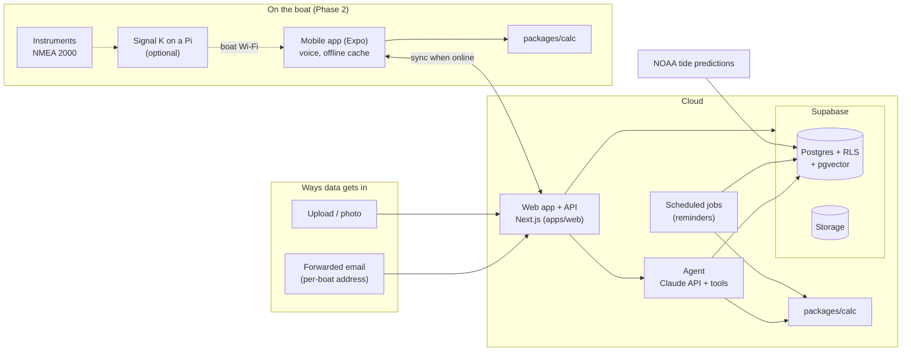
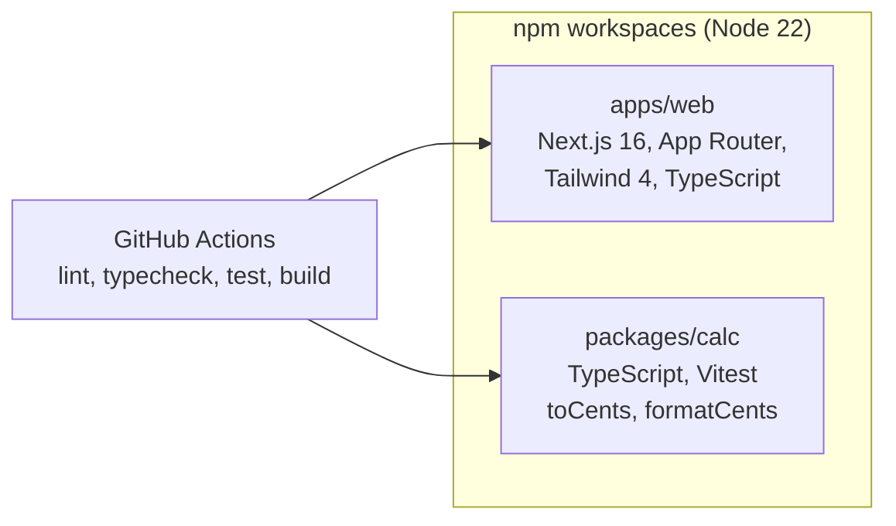
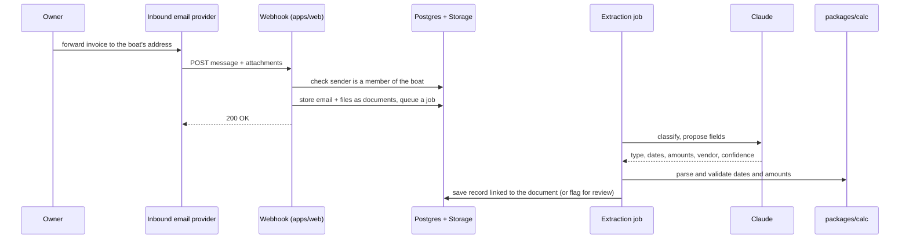
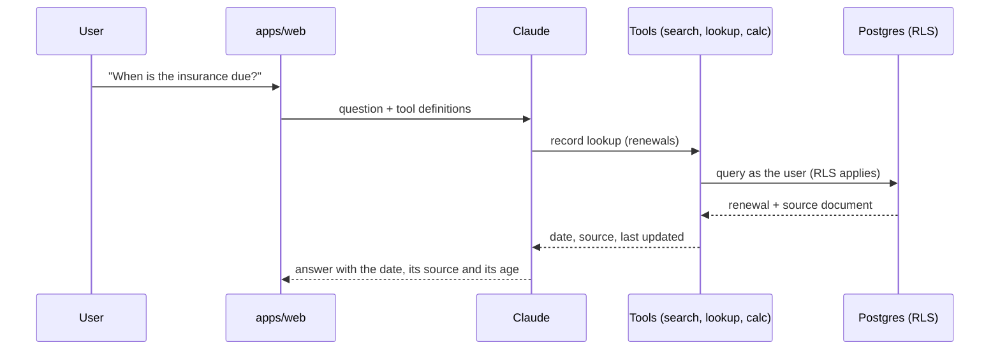
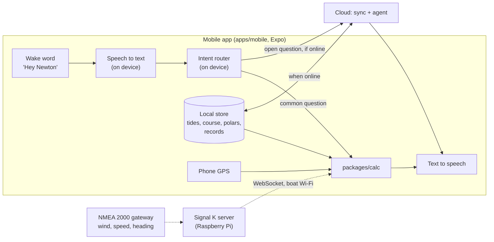

# Architecture

How Newton is built today, and what each build phase adds. The product view (users, data
model, agent tools, risks) is in the "Newton — Product & Architecture Spec" in the team Google
Drive; this page is the engineering view and stays in step with the code.

**Status (last updated 2026-10-18):** Phase 1, scaffold only. What exists today is in
[Today: the scaffold](#today-the-scaffold); every other section describes a target, not running
code. Update this line when a phase's components land.

Anything marked **(open)** has not been decided yet. Each open choice gets a short decision record
in `docs/decisions/` when an issue needs it.

- [The target shape in one picture](#the-target-shape-in-one-picture)
- [Rules every part follows](#rules-every-part-follows)
- [Today: the scaffold](#today-the-scaffold)
- [Phase 1 target: home side for our own boat](#phase-1-target-home-side-for-our-own-boat)
- [Phase 2 target: on-water voice](#phase-2-target-on-water-voice)
- [Phase 3 target: friends' boats](#phase-3-target-friends-boats)
- [Phase 4 target: paid product](#phase-4-target-paid-product)
- [Open decisions](#open-decisions)

## The target shape in one picture

This is where the phases lead, not what runs today. One cloud service holds every boat's record. The web app (Phase 1) and the mobile app (Phase 2)
read and write it; on the boat, the mobile app works from a cached copy and syncs when it has
signal. Every number comes from `packages/calc`, which runs both in the cloud and on the phone.



## Rules every part follows

These are the [principles](../README.md#principles) turned into technical rules.

| Principle | Technical rule (applies as each part is built) |
| --- | --- |
| 1. The boat is the tenant | Every table has a `boat_id`. Access is enforced by Postgres row-level security (RLS) from a person's membership on that boat, not by app code. User requests run with the user's own token, so RLS applies. The service role (which bypasses RLS) is only used by server jobs and webhooks, which always filter by an explicit `boat_id`. |
| 2. Numbers from code | Tides, bearings, target angles, dates and cost splits live in `packages/calc` as pure, unit-tested functions. The agent gets numbers only as tool results; values extracted from documents are parsed and validated by `calc` before saving. Money is integer cents. |
| 3. Zero data entry | Email-in and upload are the main input paths. Forms are only for correcting what extraction proposed. |
| 4. Offline first on the boat | `packages/calc` has no Node, browser or network dependencies, so the phone will be able to run it offline in Phase 2. Anything the on-water assistant needs is cached on the phone. |
| 5. Owners own their data | Every record and file can be exported per boat. Nothing about a boat lives outside the boat's rows and its storage folder, so a record can move to a new owner. |
| 6. Safety framing | Every fact carries its source (document, page, station) and its timestamp, so answers can say where a number came from and how old it is. Records keep an audit trail: who added or changed them, and from which email or file. |

## Today: the scaffold

What is in `main` now (after [#18](https://github.com/heynewton/newton/pull/18) and
[#20](https://github.com/heynewton/newton/pull/20)): a monorepo with a placeholder web page and
the first `calc` functions. There is no database, auth, agent or email yet.



| Part | Where | State |
| --- | --- | --- |
| Web app | `apps/web` | Homepage, placeholder `/get-started`, `/sign-in`, `/privacy` and `/terms`, and a shared footer from the root layout (#31). No auth, no data. Previews per PR (#19). |
| Calc | `packages/calc` | Money helpers (`toCents`, `formatCents`) with tests. Imported as source (`main: src/index.ts`), no build step. |
| Brand | `assets/brand` | Logo, favicon, monochrome marks. |
| CI | `.github/workflows/ci.yml` | `npm ci`, lint, typecheck, test, build on every PR and on `main`. |
| Fixtures | `fixtures/` | Planned (#4); not created yet. |
| Database, auth, storage | — | Not started (#5). |
| Agent, email-in | — | Not started (#10, #11). |

Commands: `npm run dev`, `npm run check`, `npm run build` (see the
[README](../README.md#development)).

## Phase 1 target: home side for our own boat

**Goal:** forward an email and Newton files it; renewals and maintenance come with reminders;
co-owners see who owes whom; questions about the manuals are answered with sources.

### Components

| Component | Choice | Issues |
| --- | --- | --- |
| Web app and API | Next.js in `apps/web`: pages for people, route handlers for webhooks and the API. One deployable. | #15 |
| Hosting | Vercel, with a preview link on every PR (proposed in #19). | #19 |
| Database and auth | Supabase Postgres with RLS. Migrations checked in under `supabase/`, local stack via the Supabase CLI. Supabase Auth: email magic link first, then Google and Apple ([decision](decisions/0001-auth.md)). RLS policies go through a `current_person_id()` function, so the auth provider can change without rewriting them. | #5, #27 |
| Records | Tables: `boats`, `people` (Newton's own ID; the auth provider's ID only in `auth_subject`; verified sender addresses for email-in), `memberships` (role, ownership share), `documents`, `renewals`, `maintenance_items`, `expenses`. Each record can link to its source document. | #5, #8, #9, #27 |
| File storage | Supabase Storage, one folder per boat (`<boat_id>/…`), protected by storage RLS policies. | #8 |
| Email-in | An inbound email provider **(open)** posts each message to a webhook in the web app. The webhook stores the raw email and attachments as documents of that boat and returns quickly. Mail from senders who are not members is held, not filed. Senders are matched against each person's verified sender addresses, not their login, since an Apple login can be a relay address. | #10, #27 |
| Extraction | Claude classifies each document and proposes fields. `calc` parses and validates dates and amounts before anything is saved. Low-confidence results are flagged for review. | #11 |
| Background work | Extraction and indexing run outside the webhook request, from a jobs table **(open: Supabase queue/cron or a hosted job runner)**. | #11, #13 |
| Calculations | `packages/calc`: cost split, due dates. | #6, #7 |
| Reminders | A daily scheduled job finds what is due (via `calc`) and sends one digest per person. Each sent item is recorded so it is not sent twice. Outbound email provider **(open)**, likely the same as inbound. | #12 |
| Document search | Manuals split into chunks with page numbers, embedded into pgvector in the same database, under the same RLS. Embedding provider **(open)**. | #13 |
| Q&A | Claude with tool use: document search and record lookup. Answers cite the document and page, and say so when the manuals don't cover the question. | #14 |
| Export | One archive per boat: every record as JSON plus every file. Owners and co-owners only. | #16 |
| Evals | Fixture-based evals for extraction and Q&A, checked in and run like tests. | #11, #14 |

### Planned layout

```text
apps/web/            Next.js: screens, API routes, inbound-email webhook
packages/calc/       pure functions for every number (cloud and phone)
packages/agent/      prompts, tool definitions, evals (proposed, when #11 starts)
supabase/            migrations, RLS policies, seed from fixtures, RLS tests
fixtures/            fake sample boat, documents, .eml files
docs/decisions/      one short record per decision
```

### Email-in to a filed record



### A question about the boat



The model never computes or recalls a number; if no tool returned it, the answer doesn't
contain it.

## Phase 2 target: on-water voice

**Goal:** hands-free answers on the boat. First tide and course-to-mark from the phone's GPS
and cached data; then target angles from the instruments via Signal K.

**What it needs from Phase 1:** only sign-in, boats and memberships (#5), so the phone knows
which boat it is on and can sync. The on-device path (`calc` functions, cached tides, voice)
needs nothing else from Phase 1, so its `calc` and tide work can start before Phase 1 is done.
The cloud path for open questions reuses the Phase 1 agent and document search (#13, #14) once
they exist.



| Area | What is added |
| --- | --- |
| Mobile app | `apps/mobile` with Expo / React Native, reusing `packages/calc` as is. |
| Voice | Wake word, speech-to-text and text-to-speech on the phone, so they work without signal and in wind noise. Engines **(open)**. |
| Fast path | An on-device intent router maps common questions (tide, course to mark, target angle) to a `calc` function and speaks the result, number first, with its source and age. No cloud round-trip. |
| Cloud path | Open questions go to the cloud agent when online; offline, Newton says it can't answer. |
| Offline cache | A local store on the phone **(open: SQLite or similar)** holding what the fast path needs: tide predictions for nearby stations, the active course, the sailing profile, key records. Synced down before leaving; logs synced up after. |
| Tides | NOAA predictions fetched by the cloud and cached per station, then copied to the phone. NOAA covers US stations only; other regions need another source **(open)**. |
| New calc | Tide height and current at a time, bearing and distance to a mark, time to mark, then target angles from polars. Each with unit tests against published values. |
| New records | Sailing profile (polars, sails, instrument setup), courses with marks, navigation log. |
| Signal K | Optional Raspberry Pi on the boat running Signal K with an NMEA 2000 gateway. The phone reads live wind, speed and heading over the boat's Wi-Fi. Nothing on the boat needs the internet. |
| Alerts | Later in the phase: low depth ahead and strong wind, spoken and pushed, working offline from cached data. |

## Phase 3 target: friends' boats

**Goal:** three to five boats onboard themselves, and we measure how long until a new boat is
useful. The architecture stays the same; this phase makes it safe and measurable for people
who aren't us.

| Area | What is added |
| --- | --- |
| Onboarding | Create a boat, get its email address, invite co-owners and crew by email with a role. Bulk upload of existing documents (a folder of PDFs or photos). Set up the on-water side too: install the mobile app, enter the sailing profile (polars), and optionally connect Signal K. |
| Upload | Photo and file upload in the web app, using the same extraction path as email-in. |
| Measuring | A small events table (boat created, first document filed, first reminder sent, first question answered, first voice answer on the water) to measure time to useful. No third-party analytics with boat data. |
| Isolation | RLS tests for every table become a CI gate; a cross-boat leak test using two fixture boats. |
| Cost per boat | Log model tokens and storage per boat, to know what a boat costs to run (a Phase 4 input). |
| Operations | Error tracking **(open)**, database backups, and a dev/prod split of Supabase projects. |
| Abuse | Rate limits on the inbound webhook and on Q&A per boat. |

## Phase 4 target: paid product

**Goal:** a per-boat subscription. Mostly operations and product work on the same architecture.

| Area | What is added |
| --- | --- |
| Billing | Stripe, per boat. Until then, only a `plan` field on `boats`. |
| Hosting | Move off plans limited to non-commercial use (the Vercel Hobby plan, if it was chosen in #19). Production Supabase on a paid tier with point-in-time recovery. |
| Ownership transfer | Move a boat record to a buyer: memberships change, history and audit trail stay. |
| Data rights | Account deletion and export as self-serve flows; data retention rules; privacy policy and terms (Newton supports, and does not replace, navigation and seamanship). |
| Fleets | Many boats under one manager (charter fleets, schools), if that market is chosen. Builds on memberships rather than a new tenant type. |
| Scale | Per-boat cost limits on model use, and caching of repeat questions. |

## Open decisions

Each becomes a record in `docs/decisions/` when the issue that needs it starts. Decided so far:
[0001 Auth](decisions/0001-auth.md).

| Decision | Needed by | Notes |
| --- | --- | --- |
| Hosting for the web app | #19 | Vercel proposed. |
| Inbound (and outbound) email provider | #10, #12 | Must post inbound mail with attachments to a webhook. |
| Where background jobs run | #11, #12 | Supabase (queues, cron, edge functions) or a job runner next to the web app. |
| Embedding provider | #13 | Stored in pgvector either way. |
| Tide source outside the US | Phase 2 | NOAA is US only. |
| On-device voice engines | Phase 2 | Wake word, speech-to-text, text-to-speech, all offline. |
| Phone offline store and sync | Phase 2 | Conflict rules for logs written offline. |
| Racing or cruising first on the water | Phase 2 | Open product question in the spec; decides target angles versus ETA and shelter first. |
